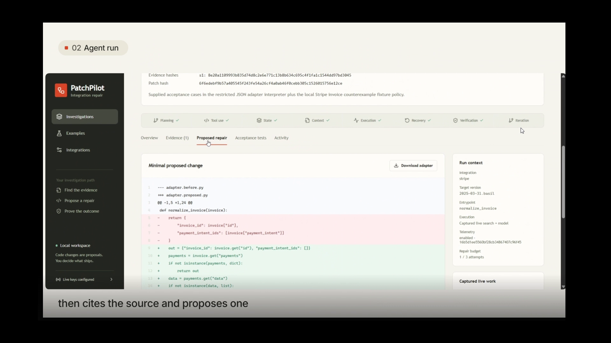
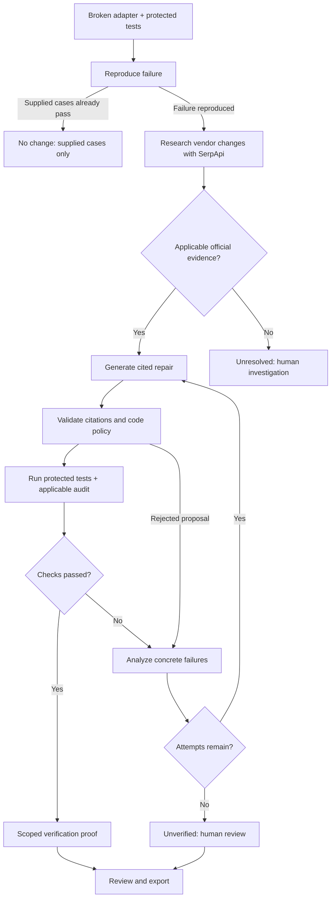
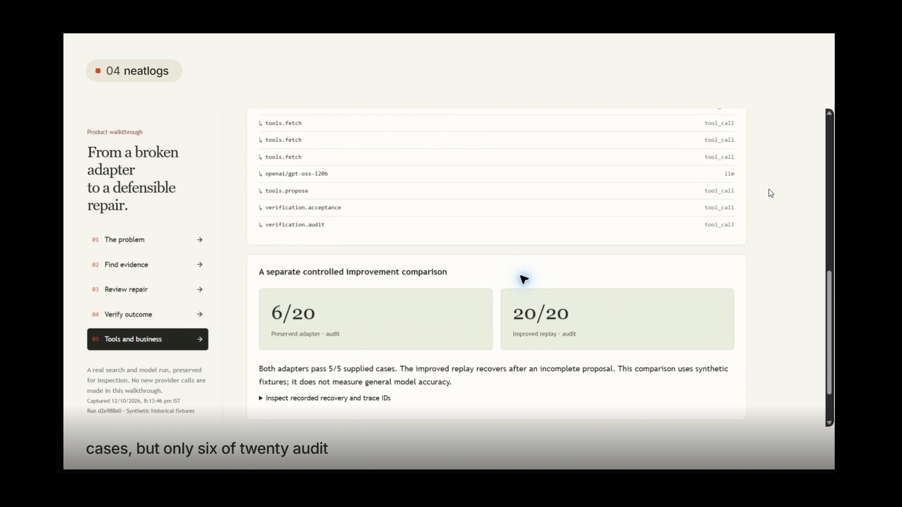

<div align="center">

# PatchPilot
### API changed. Your contract stays.

**An AI agent that investigates broken API adapters, proposes a cited repair, and tests what your application must preserve.**

[](pyproject.toml)
[](https://github.com/sankalp2515/PatchPilot/actions/workflows/verify.yml)

[](LICENSE)

[Watch the 3-minute demo](https://x.com/WanjariSankalp/status/2109713349017747529) · [Run locally](#run-locally) · [How the agent works](#how-the-agent-works) · [API guide](docs/api-guide.md)

</div>

A vendor moves one field. Your integration breaks. Finding the replacement is only half the job: the repair still has to preserve the output your application depends on, including the cases an obvious patch misses.

PatchPilot brings the investigation into one workspace: **official evidence, a focused code diff, protected tests, and a repair record you can review and export.** Built for developers maintaining Python adapters around third-party APIs. You decide what ships.

[](https://x.com/WanjariSankalp/status/2109713349017747529)

*Watch the product walkthrough: define a broken integration, inspect the agent's evidence and patch, then review verification and engineering decisions. The video presents a saved investigation; it does not make new provider calls during playback.*

## One migration. The same application contract.

The included Stripe example targets `2025-03-31.basil`. The old adapter expects an invoice's top-level `payment_intent`; the migration removes that field and introduces invoice-payment relationships.

| Before | After |
|---|---|
| Read `invoice["payment_intent"]` → `KeyError` | Read payment-intent IDs through `invoice["payments"]["data"]` |
| Assume one payment per invoice | Handle multiple payments and expanded ID objects |
| Five protected cases fail | The repaired adapter passes **5/5 protected cases + 20/20 scoped audit cases** |
| Application expects `invoice_id` and `payment_intent_ids` | **The output contract stays unchanged** |

```json
{"invoice_id": "in_demo", "payment_intent_ids": ["pi_001", "pi_002"]}
```

The agent discovers the relevant official release note through **SerpApi Google Search**, fetches the source text, and checks literal supporting quotations before accepting a proposal. Search snippets are leads; fetched vendor evidence is the basis for repair.

## Why use an agent for this?

- **Investigate before editing.** Reproduce the failure, research the target version and select applicable official evidence.
- **Keep the contract fixed.** The agent revises code, not your acceptance cases or expected outputs.
- **Learn from failed checks.** Each unsuccessful proposal returns concrete test or validation feedback to the next attempt.
- **Stop with an honest outcome.** Missing evidence, account failures and exhausted repair attempts stay unresolved.
- **Hand off a reviewable repair.** Export the adapter, diff, citations, case results and scoped proof. SQLite checkpoints retain the investigation and support resuming interrupted work.

## How the agent works



This is a bounded feedback loop, not a single code-generation call. The agent carries sources, protected inputs and failed attempts forward; allows up to three proposals; and enforces a 240-second run timeout. Interrupted runs reuse saved research and remaining attempts. Passing saved proposals are revalidated on resume.

The execution boundary is deliberately narrow: one JSON-to-JSON Python function runs in a restricted AST interpreter, without `exec`, `eval`, imports, shell, filesystem or network access. See [system design](docs/system-design.md) for the lifecycle and [architecture](docs/architecture.md) for components, trust boundaries and infrastructure.

## Evidence you can inspect

| Validation | Observed result | Inspect the record |
|---|---|---|
| Live Stripe investigation | Real SerpApi discovery and model proposal; **0/5 → 5/5** protected cases, **20/20** applicable audit cases | [Live run receipt](docs/live-verification.json) |
| Live repair recovery, shown below | First proposal passed acceptance but only **14/20 audit cases**; a second proposal passed **20/20** | [Investigation screenshot](docs/assets/repair-proof-desktop.png) |
| Controlled adapter comparison | Preserved adapter: **5/5 acceptance, 6/20 audit**. Improved recovery example: **5/5, 20/20**, after two attempts | [Trace comparison and readback](docs/evidence/neatlogs-improvement.json) |
| Automated regression checks | Provider failure handling, policy boundaries, agent outcomes and UI behavior | [CI workflow runs](https://github.com/sankalp2515/PatchPilot/actions/workflows/verify.yml) · [Testing guide](docs/testing.md) |

The live runs use real search and model calls against public documentation, with synthetic historical response fixtures for verification. The controlled comparison evaluates the same local contract using recorded evidence and fixed proposals; it is a separate experiment, not a measure of general LLM accuracy.



*The separate controlled comparison exposes what the five known cases miss: audit coverage improves from 6/20 to 20/20. The [full live recovery trail](docs/assets/repair-proof-desktop.png) also records a real model proposal improving from 14/20 to 20/20 after verification feedback.*

### What “verified” means

Candidate repairs must pass the unchanged acceptance cases and any applicable independent local audit. The 20-case audit covers the matching Stripe invoice contract, including malformed containers, unsupported payment kinds and expanded payment-intent IDs. It is separate from the supplied cases, not an external certification.

**An adapter that already passes every supplied baseline case currently returns `no_change` before research or the additional audit.** PatchPilot challenges candidate repairs; it does not yet offer an audit-only mode for already-passing adapters. The controlled comparison above evaluates that verification gap separately.

Proof hashes bind the contract, sources, patch and results so artifacts can be compared. They are not signatures or guarantees of correctness outside the tested scope.

## Run locally

### Start the workspace

Requires Docker with Linux containers and Docker Compose 2.24+.

```sh
git clone https://github.com/sankalp2515/PatchPilot.git
cd PatchPilot
docker compose up --build -d
```

Open [localhost:8017](http://127.0.0.1:8017) when the service is healthy, then select **Open workspace**. The Compose volume retains investigations across restarts.

| Your goal | Where to start | Accounts needed |
|---|---|---|
| Understand the product | **Product walkthrough** on the homepage, or [/app/showcase](http://127.0.0.1:8017/app/showcase) | None; inspect a saved live investigation and its labelled evidence |
| Exercise the recovery loop | **Recovery from an incomplete repair** in the workspace; keep its default mode | None; bundled evidence and fixed proposals, with failures verified locally |
| Investigate with fresh search and AI | **Stripe invoice migration** → **Live search + AI** | SerpApi + a supported model provider |

The account-free recovery example supports the bundled Stripe version, `normalize_invoice` and its unchanged cases. It makes no search or model requests. Use live mode for custom incidents; live failures never silently switch to the account-free example. [Complete user flows →](docs/user-flows.md)

### Enable fresh investigations

Copy [.env.example](.env.example) to `.env` if you do not already have one. Set `SERPAPI_API_KEY` and one model provider's key, then restart the service.

| Provider | `LLM_PROVIDER` | Required key | Default model |
|---|---|---|---|
| Groq | `groq` | `GROQ_API_KEY` | `openai/gpt-oss-120b` |
| NVIDIA | `nvidia` | `NVIDIA_API_KEY` | `openai/gpt-oss-20b` |

`LLM_MODEL` overrides the default. Optional `NEATLOGS_API_KEY` enables operational tracing. No Stripe payment API is called. Provider access and quotas apply. [Configuration and integrations →](docs/integrations.md)

<details>
<summary><strong>Native setup and development checks</strong></summary>

Install Python 3.12, Node.js 22.12+ and preferably `uv`. On Windows:

```powershell
.\scripts\run.ps1
```

This installs dependencies, builds the UI and starts the service. On macOS/Linux, run `./scripts/setup.sh` then `./scripts/start.sh`. Native data and logs live under `.data/`. Windows `scripts/stop.ps1` stops the project's recorded process.

```sh
uv sync --python 3.12 --extra dev
uv run pytest -q
uv run ruff check patchpilot tests scripts
npm --prefix web ci
npm --prefix web test
npm --prefix web run build
```

Browser checks: start the server, run `npx --prefix web playwright install chromium`, then `npm --prefix web run test:e2e`. `uv run python -m scripts.live_smoke` performs fresh provider requests and saves a sanitized receipt. See [contributing](CONTRIBUTING.md) and [testing](docs/testing.md).

</details>

## Engineering decisions behind the product

| Tool | How we used it | Resulting decision and evidence |
|---|---|---|
| **SerpApi** | Discover official, version-specific migration sources for live repairs | Require fetched source evidence before generating a patch. [Live receipt](docs/live-verification.json) |
| **neatlogs** | Trace research, model calls, verification and recovery; inspect controlled before/after outcomes | Make acceptance gaps and repair attempts observable. The comparison moves from 6/20 to 20/20 audit cases. [Trace evidence](docs/evidence/neatlogs-improvement.json) |
| **Entire** | Preserve an actual Codex code-review session, retrospectively attached as a checkpoint | A reproducibility concern led to pinning Python 3.12 in setup and Docker. [Checkpoint receipt](docs/evidence/entire-checkpoint.json) |
| **cfo.ai** | Model three editable scenarios for pricing, usage, provider costs, reviewer effort and runway | Treat reviewer effort as a commercial assumption to validate in a pilot. [Business model](docs/business-model.md) · [Model readback](docs/evidence/cfo-model.json) |

neatlogs is optional runtime observability. Entire supports development provenance; cfo.ai supports business planning. Neither is required to run the agent. The Entire record is retrospective, not continuous historical capture. Business scenarios are illustrative assumptions, not measured customers, revenue or demand; billing is not implemented.

## Boundaries and data handling

PatchPilot is a local, single-user early release. Discovery supports Stripe, GitHub, Slack and Shopify; the demonstrated migration and independent audit are Stripe-specific. Custom repairs need precise public evidence and supported interpreter constructs. The agent exports proposals; it does not modify, merge or deploy your repository.

Live investigations send incident details, adapter code, cases and selected documentation to the model provider, and search terms to SerpApi. Use sanitized inputs. Keys stay server-side; neatlogs tracing excludes raw prompts, code, cases and completions. Public hosting requires authentication, authorization and operational hardening. [Security and data boundaries →](SECURITY.md)

## Explore further

[Documentation](docs/README.md) · [Architecture](docs/architecture.md) · [System design](docs/system-design.md) · [API guide](docs/api-guide.md) · [User flows](docs/user-flows.md) · [Design system](docs/design.md) · [Contributing](CONTRIBUTING.md)

Released under the [MIT License](LICENSE), copyright 2026 Sankalp. Built with AI assistance; evaluations use synthetic fixtures. Third-party packages and vendor documentation retain their rights.
