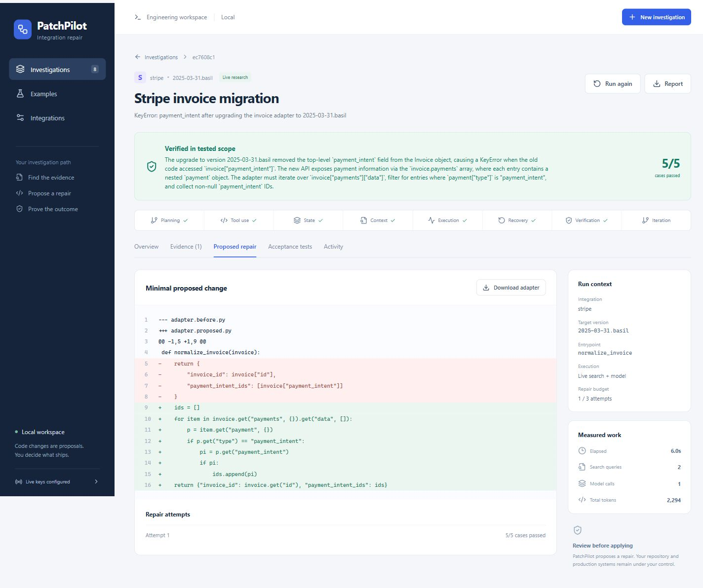

# PatchPilot

An AI agent that investigates a failing API adapter, discovers version-specific vendor evidence with SerpApi, proposes a minimal Python repair, and verifies it against protected acceptance cases.

[Source repository](https://github.com/sankalp2515/PatchPilot)

**Open the running workbench: http://127.0.0.1:8017**



## Try it now

1. Open the workbench and choose **Recovery from an incomplete repair**. Leave **Recorded replay** selected and start the investigation. The first proposal fails multiple-payment and unsupported-payment cases; the next proposal passes all five. This is explicitly a deterministic demonstration, not live AI.
2. Choose **Stripe invoice migration** and leave **Live search + AI** selected. This uses the privately configured SerpApi and Groq credentials, discovers real public Stripe documentation, generates a repair using the model, and tests it on local historical response fixtures. No payment API is called.
3. Inspect **Evidence**, **Proposed repair**, **Acceptance tests**, and **Activity**. Download the proposed adapter and the Markdown or JSON report.
4. For your own response data, open **Examples → Custom incident**. Paste a sanitized Python adapter, target vendor/version, observed failure, and a JSON array of `{name, input, expected}` cases. Only Stripe, GitHub, Slack and Shopify official hosts are supported. Prefer one precise error/field and a version with public migration documentation.

The machine-readable API specification is available at http://127.0.0.1:8017/openapi.json.

In live mode your incident fields, adapter, sanitized acceptance cases and selected documentation are sent to the configured model provider. Search hints and symptom terms are sent to SerpApi. Test execution remains local. Remove private customer data before using live mode.

## Local startup

From PowerShell in this folder:

```powershell
.\scripts\setup.ps1
.\scripts\start.ps1
```

Setup installs locked Python and frontend dependencies and builds the UI. The server serves the production frontend at loopback port 8017. Start is idempotent; the helper launches a hidden process, saves its PID and writes logs under `.data/`. Stop only this project's recorded server:

```powershell
.\scripts\stop.ps1
```

Run history persists in `.data/patchpilot.db`. After an unexpected restart, incomplete investigations become **Ready to resume**. Resuming reuses saved evidence and preserves the repair attempt budget; a saved passing proposal is rechecked before finalization.

Requires Python 3.12 or newer and Node.js 22.12 or newer. `uv` is recommended; setup includes a pip fallback. Docker is optional: `docker compose up --build -d`. Docker packaging is provided, but the overnight verified runtime is the native Windows setup.

## Credentials

`.env` is local, ignored by Git, and loaded only on the server. No key values are embedded in source, docs, screenshots, or the UI.

For another installation, copy `.env.example` to `.env` and set `SERPAPI_API_KEY` and either `GROQ_API_KEY` or `NVIDIA_API_KEY`. Optional `LLM_PROVIDER` selects `groq` or `nvidia`; `LLM_MODEL` overrides its default. Existing Groq configuration uses `openai/gpt-oss-120b`. Replay does not require keys. Provider account quotas and model permissions are reported as real run failures, never silently replaced with replay.

## What the agent does

| Focus area | Implemented behavior |
| --- | --- |
| Planning | Saves the incident plan, test scope and retry/time budgets before acting. |
| Tool use | Calls SerpApi, acquires official pages, generates a model proposal, checks AST policy and runs cases. |
| State | SQLite checkpoints preserve sources, attempts, decisions, cancellations and outputs. |
| Context | Filters official hosts, target versions and incident terms; validates literal source quotations. |
| Execution | Completes a bounded adapter repair workflow and produces code, diff and reports. |
| Recovery | Retries provider transport once, follows a vendor release index when discovery is adjacent, resumes interrupted work and refuses unsupported incidents. |
| Verification | Immutable cases and strict JSON comparison determine the outcome; source citations must exist and address incident context. |
| Iteration | Failed case results or citation/AST rejections guide subsequent proposals, up to three attempts. |

## Security and scope

The repair target is a single JSON-to-JSON Python adapter function. Code runs through a bounded AST interpreter; there is no `exec`, `eval`, import, filesystem, shell, network or arbitrary repository execution. Supported constructs and methods are documented in [system design](docs/system-design.md). Inputs, graph traversal, output sizes, arithmetic, retries and runtime are bounded. Unsafe code is rejected. API requests are restricted to approved local Host names and same-origin browser mutations.

Passing cases establish correctness only for those cases. PatchPilot proposes a downloadable artifact and never auto-merges, deploys, modifies payment credentials, or writes into a customer repository. Use sanitized data; obvious credential-bearing input is rejected. The application is a local single-user MVP, not an authenticated public SaaS deployment.

## Tests

```powershell
.venv\Scripts\python.exe -m pytest -q
.venv\Scripts\python.exe -m ruff check patchpilot tests scripts
cd web
npm test
npm run build
npm run test:e2e
```

Browser tests require a running server and Playwright Chromium (`npx playwright install chromium`). They exercise repair/recovery, source and test views, report downloads, mobile layout, invalid JSON and credential rejection. Live smoke is intentionally separate from automated tests: from the repository root run `.venv\Scripts\python.exe -m scripts.live_smoke`; it consumes real provider requests and saves a sanitized summary in `docs/live-verification.json`.

## Architecture and handoff

- [System architecture](docs/architecture.md): boundaries, component relationships, security and quality attributes.
- [System design](docs/system-design.md): operational data flows, API, state and execution details.
- [Implementation plan](docs/superpowers/plans/2026-10-12-patchpilot.md): tasks and verification gates.
- [Morning partner setup](docs/morning-integrations.md): neatlogs, Entire and cfo.ai integration and required evidence.
- [Evaluation and verification](docs/testing.md): reproducible examples and limitations.
- [Business assumptions](docs/economics.md): inputs to validate and model in cfo.ai.

neatlogs, Entire and cfo.ai account-backed integration is deliberately **pending** setup. Local traces, Git commits and a financial worksheet are preparation, not sponsor compliance. Git history records the actual development work; hackathon eligibility and submission still need review. The GitHub repository is available for integration work; no hackathon entry, demo upload or public social post has been submitted.
