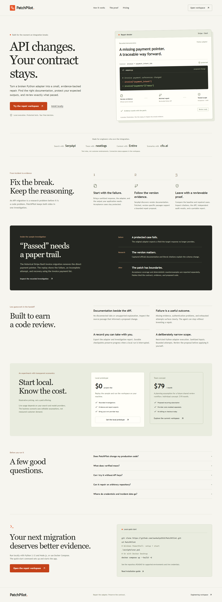
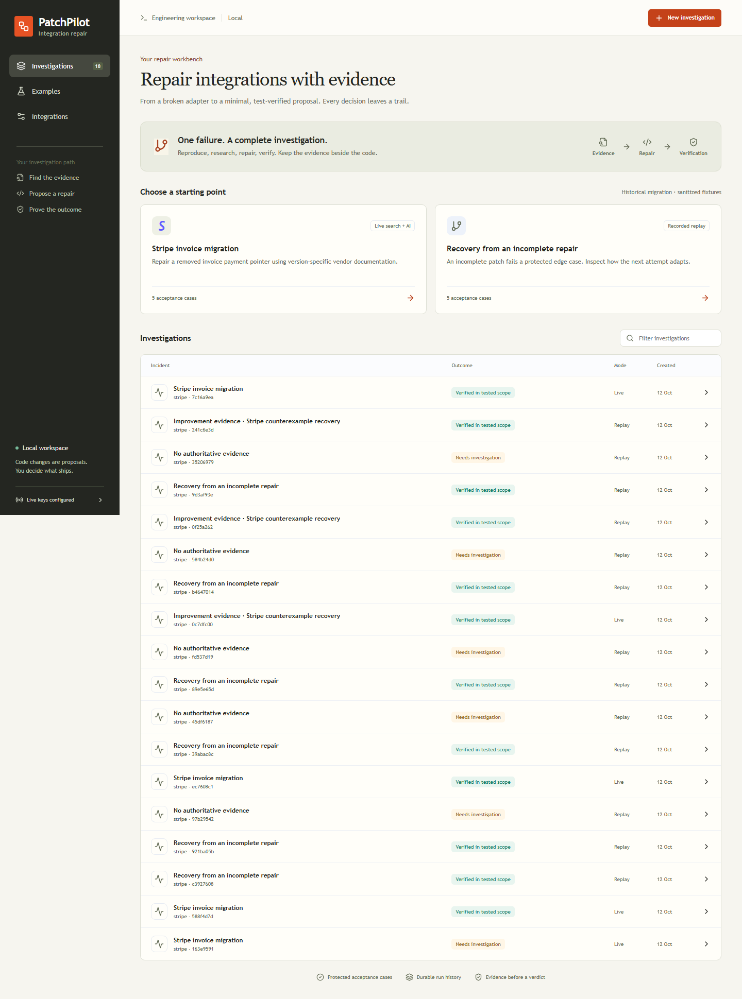
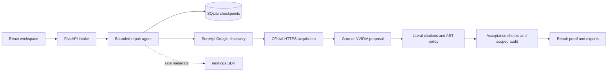

<div align="center">

# PatchPilot
### From broken adapter to evidence-backed repair.

A local AI agent that investigates API migrations, proposes a minimal Python patch, and packages the evidence with its tested scope.


[](https://github.com/sankalp2515/PatchPilot/actions/workflows/verify.yml)

[](LICENSE)

[Get started](#get-started) · [User flows](docs/user-flows.md) · [Architecture](docs/architecture.md) · [API guide](docs/api-guide.md) · [Demo scripts](docs/demo-scripts.md)

</div>

An integration can break when a vendor moves one field. Finding the replacement still requires version-specific documentation, careful handling of response shapes, and tests for the output your application expects. PatchPilot keeps the investigation together: baseline failure → SerpApi discovery → fetched official evidence → cited patch → acceptance checks → scoped repair proof.



## Why PatchPilot

- **Research the actual migration.** SerpApi Google discovery identifies candidates; fetched official documentation supplies evidence.
- **Protect the contract.** Original acceptance cases remain unchanged while the agent revises its proposal.
- **Catch an incomplete patch.** A separate 20-case local counterexample audit applies to the bundled Stripe invoice contract, covering malformed and expanded payment pointers.
- **Keep a reviewable record.** Inspect source passages, literal citations, the diff, case results, and hashes binding the contract, evidence and patch.
- **Recover work.** SQLite checkpoints preserve research and attempts; interrupted investigations can resume.

## Get started

Requires Docker with Linux containers and Docker Compose 2.24 or newer.

```sh
git clone https://github.com/sankalp2515/PatchPilot.git
cd PatchPilot
docker compose up --build -d
```

Open [localhost:8017](http://127.0.0.1:8017) after the service becomes healthy, then select **Open workspace**. The homepage explains the product; [/app](http://127.0.0.1:8017/app) opens the repair workspace. **Recorded replay works without accounts, API keys or a `.env` file.** The Compose volume retains run history across restarts. Do not remove it when retaining investigations.

For native Windows setup, install Python 3.12, Node.js 22.12 or newer, and preferably `uv`:

```powershell
.\scripts\run.ps1
```

This installs dependencies, builds the UI and starts the local service. Setup and start scripts are available separately; `scripts/stop.ps1` stops the project's recorded process. On macOS/Linux use `./scripts/setup.sh` then `./scripts/start.sh`. Native data and server logs live under `.data/`.

### Try the recovery example

1. Choose **Recovery from an incomplete repair** in the workspace.
2. Leave **Recorded replay** selected and start. The initial proposal misses cases; the agent uses actual failures to revise it.
3. Inspect **Evidence**, **Proposed repair**, **Acceptance tests**, **Activity**, and **Repair proof**.
4. Download the adapter and JSON or Markdown report. Review before applying the patch yourself.

Replay is a deterministic demonstration using recorded vendor evidence. It does not call a model or represent live AI performance. It supports the recorded Stripe `2025-03-31.basil` contract, `normalize_invoice`, and its unchanged five acceptance cases; use live mode for custom vendors, versions or contracts.



### Run live research

Copy [.env.example](.env.example) to `.env` only if one does not already exist. Set `SERPAPI_API_KEY` and one supported model provider's key. Preserve existing private configuration; never commit it.

| Provider | `LLM_PROVIDER` | Required key | Default model |
|---|---|---|---|
| Groq | `groq` | `GROQ_API_KEY` | `openai/gpt-oss-120b` |
| NVIDIA | `nvidia` | `NVIDIA_API_KEY` | `openai/gpt-oss-20b` |

`LLM_MODEL` overrides the default. Restart after changing configuration. Select **Stripe invoice migration** and **Live search + AI**. SerpApi discovers public vendor pages; the model proposes a repair; local fixtures verify it. No Stripe payment API is called. Account quotas and model access still apply; failures remain visible.

Live mode sends incident fields, adapter code, acceptance cases and selected documentation to the model provider. Search hints and symptom terms go to SerpApi. Supply sanitized data. Keys remain server-side. Optional `NEATLOGS_API_KEY` enables allowlisted operational tracing with content capture disabled.

## What “verified” establishes

A patch must pass supplied acceptance cases and any applicable independent local audit. The bundled Stripe `2025-03-31.basil` example has five acceptance cases and a separate 20-case audit. That audit applies only when the fetched migration source, vendor, version, entrypoint and output contract match its local normalization policy. Other incidents report that no independent policy applies.

Hashes bind the contract, cases, sources, patch, diff, baseline, citations and results. They support artifact comparison; they are not signatures or external attestations. Passing these fixtures does not establish universal correctness or vendor certification.

## Architecture



The agent plans, executes tools, selects context, persists state, retries failures and revises patches from verification feedback. It allows at most three proposal attempts and a 240-second run timeout. One JSON-to-JSON Python function runs through a restricted AST interpreter without `exec`, `eval`, imports, filesystem, shell or network access.

## Partner evidence

| Integration | Inspectable evidence | What it demonstrates |
|---|---|---|
| SerpApi | [Live verification](docs/live-verification.json), per-run provenance | Real Google discovery and fetched vendor context; outcomes depend on providers |
| neatlogs | [Before/after readback](docs/evidence/neatlogs-improvement.json) | Account-backed trace readback: preserved baseline 5/5 acceptance, 6/20 audit; enhanced replay 5/5 and 20/20 |
| Entire | [Checkpoint record](docs/evidence/entire-checkpoint.json) | Real read-only design-review session attached to commit `791e5a4`; imported retrospectively, not continuous earlier capture |
| cfo.ai | [Saved model](docs/evidence/cfo-model.json), [economics](docs/economics.md) | Three illustrative USD scenarios, 45 selected cells, 44 nonempty cells, zero formula errors |

The neatlogs comparison is a synthetic same-contract adapter evaluation, not an LLM accuracy benchmark. cfo.ai assumptions are not measured revenue, customers or demand. Subscription concepts are hypotheses; billing is not implemented.

## Develop and verify

```sh
uv sync --python 3.12 --extra dev
uv run pytest -q
uv run ruff check patchpilot tests scripts
npm --prefix web ci
npm --prefix web test
npm --prefix web run build
```

For browser checks, start the server, run `npx --prefix web playwright install chromium`, then `npm --prefix web run test:e2e`. Live smoke is separate: `uv run python -m scripts.live_smoke` consumes provider requests and saves a sanitized summary. Automated provider tests use controlled responses. See [contributing](CONTRIBUTING.md) and [testing](docs/testing.md).

## Documentation

| Guide | Contents |
|---|---|
| [Architecture](docs/architecture.md) | Components, boundaries, persistence and hosting |
| [System design](docs/system-design.md) | Lifecycle, verification, recovery and artifact binding |
| [User flows](docs/user-flows.md) | Replay, live, custom incidents and recovery |
| [API guide](docs/api-guide.md) | Routes, configuration, payloads and errors |
| [Design](docs/design.md) | Visual system and responsive interface |
| [Judging guide](docs/judging.md) | Eight agent focus areas, evidence and gaps |
| [Submission kit](docs/submission-kit.md) | Entry copy, partner proof and submission steps |
| [Demo scripts](docs/demo-scripts.md) | Narrated walkthroughs under three minutes |

## Scope and limitations

PatchPilot is a local single-user MVP. Discovery supports Stripe, GitHub, Slack and Shopify, but the demonstrated migration and independent audit are Stripe-specific. Custom inputs require precise public migration evidence and supported interpreter constructs. Missing evidence, auth problems, provider failures and exhausted repairs produce explicit unresolved outcomes.

Public hosting needs authentication, authorization and operational hardening. Host and same-origin checks do not replace those controls. PatchPilot exports a proposal; it does not merge, deploy or modify your repository. Human review remains necessary. See [SECURITY.md](SECURITY.md).

Released under the [MIT License](LICENSE), copyright 2026 Sankalp. Third-party packages and vendor documentation retain their rights. AI-assisted development and synthetic evaluations are disclosed; no customer testimonials or production claims are implied.
