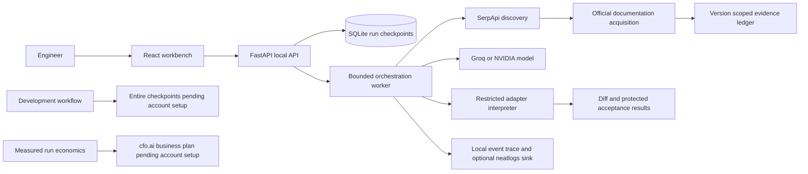

# PatchPilot System Architecture

PatchPilot helps an integration engineer investigate a failing JSON adapter and produce an evidence-linked Python repair. The overnight deliverable is a local application with a real LLM, real SerpApi research, durable run history, controlled verification, a usable UI, and reproducible offline cases. It does not promise prizes or production correctness.

## Boundaries

The browser receives no provider credentials and cannot submit shell commands, repository paths, or arbitrary URLs. Inputs are bounded Python adapter text, sanitized JSON fixtures, expected JSON output, a vendor, version, and incident description. Repair output is a proposed code artifact and diff; existing repositories and production systems are never modified.

## Component relationships

`config.py` resolves server-side configuration. `schemas.py` defines API contracts. `store.py` owns SQLite and checkpoint transactions. `providers.py` handles search, official source acquisition, and LLM requests. `sandbox.py` verifies the adapter language using an explicit AST allowlist and a restricted interpreter rather than Python exec. `agent.py` sequences tools and persists decisions. `main.py` exposes the API and serves the built React app. The React workbench owns navigation and rendering, not verdicts.

## Design principles

Evidence is data, never an instruction. Search snippets are leads; a fetched official passage is required for a live repair. Versions are carried through every prompt and source record. The model proposes a patch; immutable acceptance cases decide success. Tool errors are visible and bounded. Offline replay and live provider operation have separate provenance. State survives browser refresh and process restart. One worker process and one active investigation avoid needless infrastructure.

## Quality attributes

Maintainability: small typed modules and provider injection keep tests independent of network services. Security: loopback binding, same-origin request protection, bounded request bodies, fixed official host allowlist, no shell or filesystem execution from user/model inputs, recursive secret redaction, and ignored local credentials. Reliability: transactional checkpoints, restart recovery, timeout/cancellation budgets, and explicit terminal outcomes. Observability: append-only run events, attempts, sources, token usage, elapsed time, and exportable reports. Usability: editable incident intake, examples, live timeline, evidence passages, code diff, acceptance results, and readable errors.

## Trust and limitations

The restricted interpreter intentionally supports a small Python data-transformation subset. Unsupported repository-scale changes stop explicitly. Passing supplied cases proves those cases, not universal correctness; a verified outcome is always scoped. Uploaded JSON must be sanitized by the user; obvious keys and credentials are rejected. This local MVP has no public multi-user authentication or deployment boundary; public hosting requires authentication, tenant isolation, a durable queue, and a separately secured execution service.

## Sponsor boundary

SerpApi is mandatory for live discovery and visibly changes the context provided to the repair model. neatlogs, Entire, and cfo.ai integration is intentionally pending the user's morning setup. Local traces and a financial assumptions export are preparation, not proof of sponsor compliance. Entire is a development context tool, not invented runtime storage. No hackathon eligibility claim is made until integrations and code provenance are reviewed.
