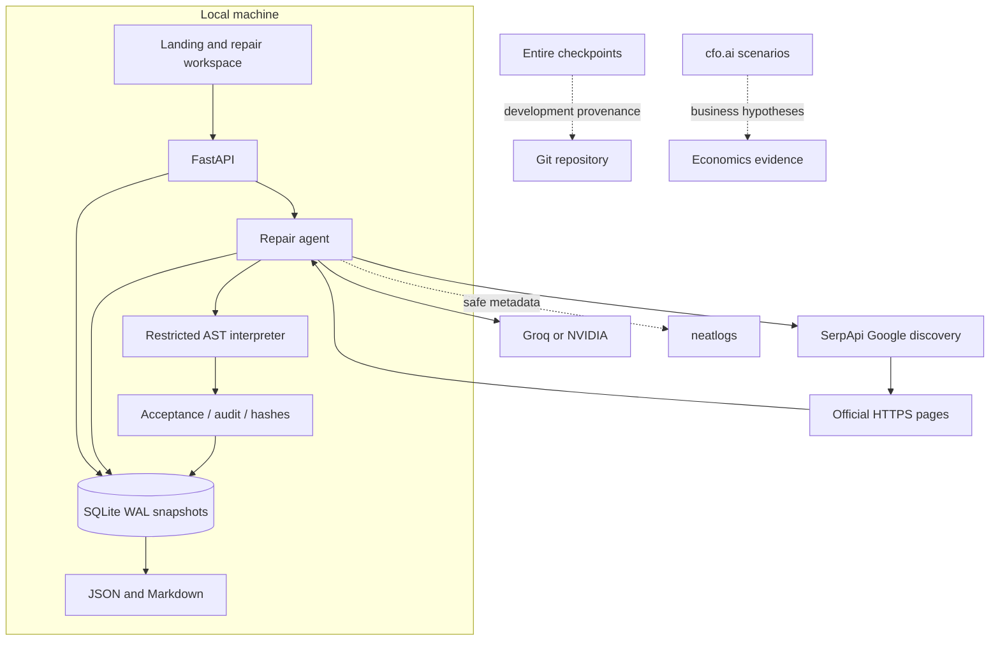

# Architecture

PatchPilot combines a React/TypeScript interface served by FastAPI, an asynchronous bounded repair agent, SQLite persistence and restricted local verification. Models propose code; deterministic guards and case results determine the reported outcome.

## Component boundaries

| Component | Responsibility | Source |
|---|---|---|
| Frontend | Intake, progress, sources, code, results and downloads | `web/src/` |
| API | Validation, local boundary, lifecycle and exports | `main.py`, `schemas.py` |
| Agent | Baseline, research, proposals, feedback and outcome | `agent.py` |
| Tools | Search, source acquisition, model calls and citations | `providers.py` |
| Interpreter | Constrained JSON adapter execution | `sandbox.py` |
| Proof | Artifact binding and scoped Stripe audit | `proof.py` |
| Store | Transactional snapshots and recovery | `store.py` |
| Telemetry | SDK lifecycle, nested spans and content exclusion | `observability.py` |

Backend files are under `patchpilot/`. Entire and cfo.ai support development and submission evidence; neither is required in the repair runtime. Replay needs no external accounts.

## Trust boundaries

Incident text, source pages and model output are untrusted. Input validation rejects obvious credential fields/token patterns, but cannot detect every secret. Acquisition accepts configured official HTTPS hosts, validates redirects and bounds responses. Snippets alone cannot unlock repair. Version/context checks and literal quote membership constrain citations.

Code never receives ordinary Python execution authority. The interpreter rejects imports, arbitrary calls/attributes and dunder identifiers, with operation and data-size budgets. Verification runs away from the API event loop. This is a narrow product language, not a general-purpose secure Python runtime.

## Persistence and recovery

Native data uses `.data/patchpilot.db`; Compose persists it in `pilot-data`. SQLite WAL snapshots retain input, evidence, baseline, attempts, events, metrics and outputs. One investigation is active at a time. Startup marks unfinished runs interrupted. Resume preserves research and used attempts; a saved passing candidate is rechecked. Cancellation is durable.

## Hosting

Native scripts bind loopback. Compose publishes port 8017 on `127.0.0.1`. The API permits localhost/loopback Hosts and rejects mismatching browser Origins for mutations. There is no authentication or tenant isolation.

Public hosting needs identity, authorization, rate limits, isolated storage, audited retention, budget accounting, backups and recovery testing. SQLite and one process limit horizontal scale. Recovery uses explicit resume rather than distributed worker leases. Telemetry failures do not block repair. Hashes are content binding, not signatures or independent certification.
