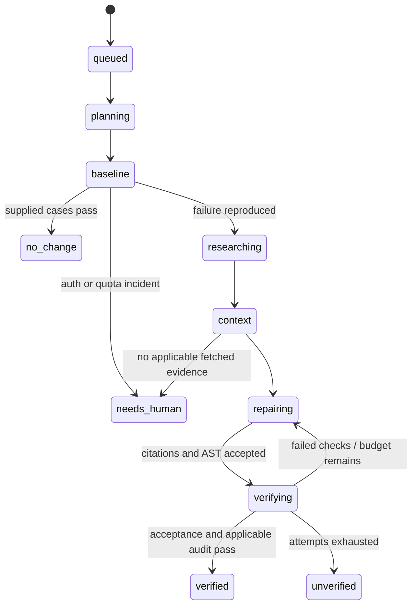

# System design

## Repair lifecycle

Cancellation, provider failure, timeout or interruption can affect intermediate phases; events record actual reasons.

1. Intake validates adapter, vendor/version and protected cases: at most 12,000 code characters, 12 supplied cases, 100,000 serialized incident characters and a 256 KB request body.
2. Planning records eight focus areas. Baseline reproduces failure. Already passing supplied cases stop as `no_change`; this early outcome is not an independent audit guarantee. Auth/rate-limit incidents require a human.
3. Live research makes at most three SerpApi searches. Bounded transport retry and official release-index fallback support recovery. Snippets identify candidates; fetched official pages supply evidence.
4. Context retains bounded source text, metadata and hashes. Every acquisition redirect must remain allowed.
5. The model returns diagnosis, code and citations. Known source IDs, substantive literal quotes, incident relevance and valid AST are required. Rejection feeds the next attempt.
6. Verification strictly compares finite JSON against the unchanged supplied cases. Failures provide actual/expected feedback. At most three proposals and a 240-second timeout bound each run.
7. Finalization requires acceptance success plus any applicable audit. Exhausted repairs remain `unverified`.

## Restricted execution

Code is parsed with AST and interpreted without `exec` or `eval`. Supported patterns include literals, JSON dictionaries/lists, indexing, assignments, conditions, bounded loops/comprehensions, selected arithmetic and approved JSON methods. Imports, classes, globals, arbitrary calls/attributes, exceptions and dunder identifiers are prohibited. Execution is capped at 20,000 operations; traversal, list growth, arithmetic and output size are bounded. No filesystem, network, process or repository access is available. See `patchpilot/sandbox.py` and tests for exact syntax.

## Acceptance and independent audit

Supplied cases define the caller's output contract and never change during repair. A separate 20-case deterministic audit applies only to Stripe `2025-03-31.basil`, `normalize_invoice`, fetched official invoice migration evidence and compatible acceptance outputs.

Cases cover malformed payment entries/pointers, expanded IDs, unsupported kinds and malformed containers. The local policy retains nonempty string payment-intent IDs and ignores malformed values. It is not a vendor guarantee and is not inferred for arbitrary incidents. “Independent” means separate from supplied cases, not external evaluators or a held-out population study.

## Artifact binding

SHA-256 hashes bind incident contract, protected cases, source text/metadata, proposed code, unified diff, baseline, citations and results. A final hash covers the proof record. Canonical JSON supports deterministic comparison. Hashes are not signatures, trusted timestamps or proof of universal correctness.

## State and recovery

SQLite snapshots store ID/timestamps, input, phase/status, plan, events, sources, baseline, attempts, verification, diagnosis, code, proof and metrics. Atomic updates protect cancellation. Startup marks incomplete runs `interrupted`. Resume preserves research and attempt count, rechecking saved passing code. Other terminal outcomes require a new run ID.

## Modes and tracing

Replay uses recorded evidence and deterministic proposals, including intentional first-attempt failure in the recovery scenario. Live uses actual SerpApi/model requests and never silently falls back to replay.

neatlogs uses a WORKFLOW root, TOOL spans for research/fetch/verification, and live LLM proposal tracing. Automatic instrumentation, content capture and log capture are disabled. Allowlisted counters, provider/model, status and outcome are sent; prompts, code, cases and raw payloads are excluded. Telemetry failure degrades observability without stopping repair. Local reports contain incident/source material and need care.
